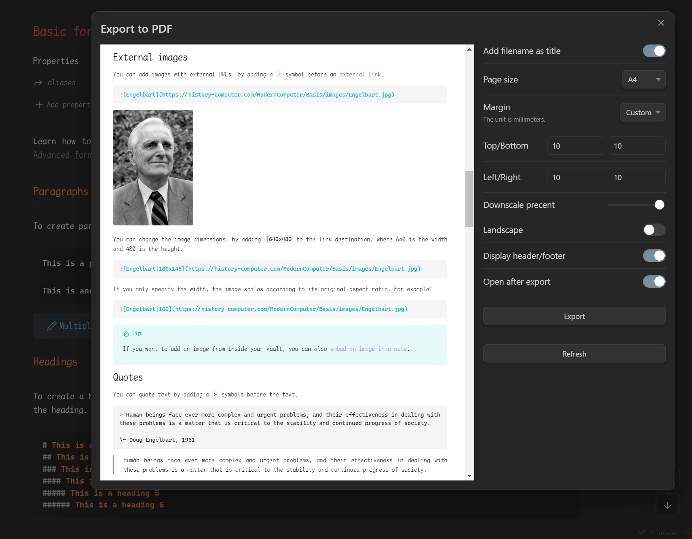
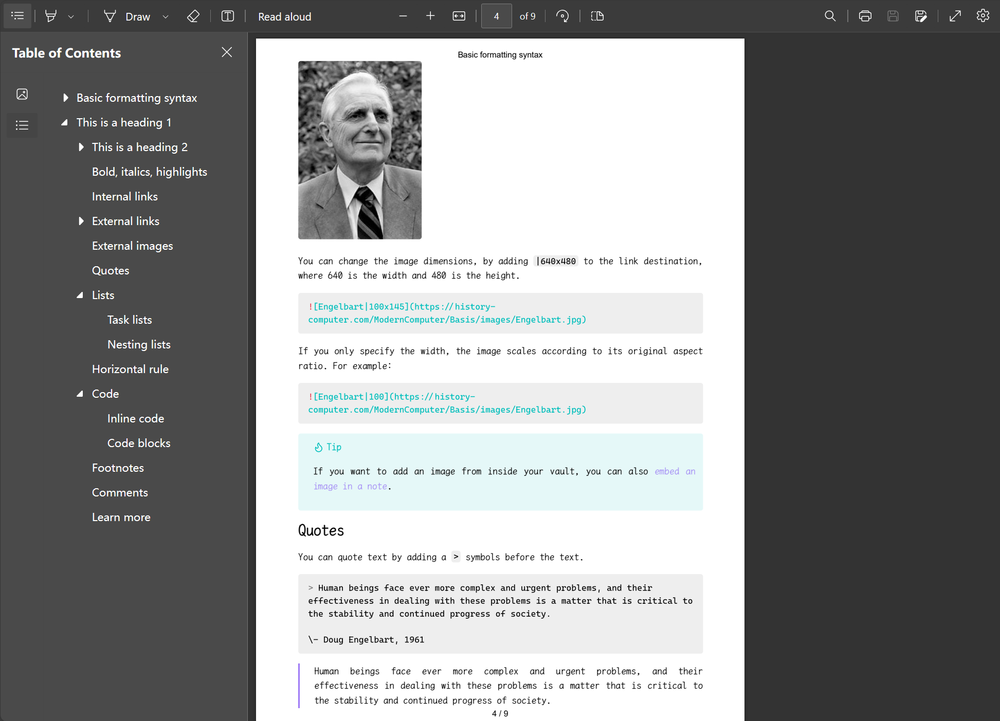

# Obsidian Better Export PDF

English | [中文](./README.zh.md)

Better Export PDF is an Obsidian PDF export enhancement plugin that adds the ability to export bookmarks outline, export preview and add page numbers to PDF compared to the official PDF export function.

Full documentation: [Better Export PDF docs](https://l1xnan.github.io/obsidian-better-export-pdf/).

## Features

Compared to the official Export PDF feature:

- 🚀Support export preview
- 🎉Export the outline bookmarks
- 🛩️Customize the margins
- ✨Export the page numbers
- 💥Support add PDF metadata from front matter
- 🎇Export internal links within file
- 🎈Export multiple Markdown files(folder or specified files) into one PDF file
- 🌸Batch export multiple PDF files
- 🍬Support exporting PDFs in any size, and can export all content onto a single page

## Installation

In Obsidian go to `Settings > Third-party plugins > Community Plugins > Browse` and search for [`Better Export PDF`](obsidian://show-plugin?id=better-export-pdf).

### Manual installation

1. Download the .zip file from [the latest Release](https://github.com/l1xnan/obsidian-better-export-pdf/releases), or from any other release version.
2. Unzip into: `{VaultFolder}/.obsidian/plugins/`
3. Reload Obsidian and enable the plug-in.

or use the [BRAT Plugin](https://obsidian.md/plugins?id=obsidian42-brat).

## Documentation

- [Export one note](https://l1xnan.github.io/obsidian-better-export-pdf/export)
- [Header, footer, and metadata](https://l1xnan.github.io/obsidian-better-export-pdf/header-footer)
- [Style, background, and page breaks](https://l1xnan.github.io/obsidian-better-export-pdf/style)
- [Folder export](https://l1xnan.github.io/obsidian-better-export-pdf/folder)
- [Command line](https://l1xnan.github.io/obsidian-better-export-pdf/cli)
- [Limits](https://l1xnan.github.io/obsidian-better-export-pdf/limits)
- [Questions from issues](https://l1xnan.github.io/obsidian-better-export-pdf/faq)

## Preview

### Export preview

### Effect picture

## Support This Plugin

This plugin takes a lot of work to maintain and continue adding features. If you want to fund the continued development of this plugin you can do so here:

 

[PayPal](https://paypal.me/l1xnan) or [WeChat or Alipay](./README.zh.md#赞助)

