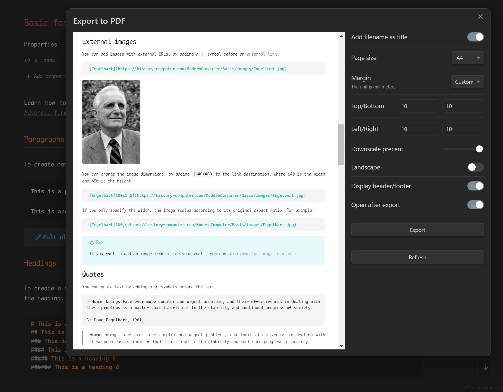
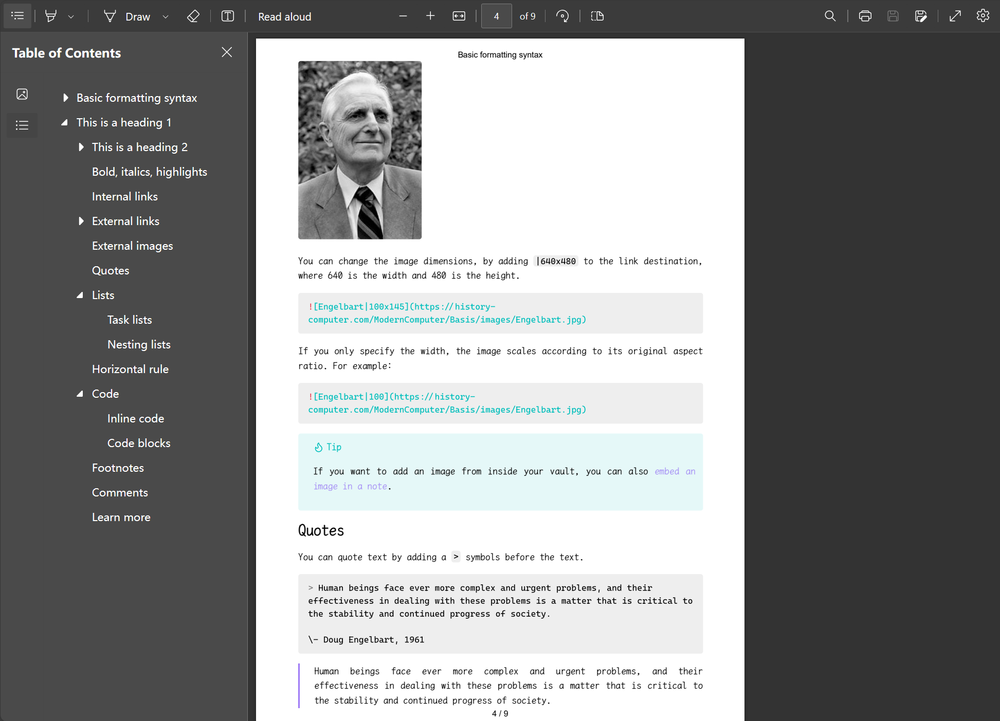

# Obsidian Better Export PDF

[English](./README.md) | 中文

Better Export PDF 是一个 Obsidian PDF 导出增强插件，与官方的 PDF 导出功能相比，增加了导出预览、导出书签大纲和给 PDF 添加页码等功能。

完整用法见 [文档](https://l1xnan.github.io/obsidian-better-export-pdf/zh/)。

## 功能

与官方导出 PDF 功能相比：

- 🚀 支持导出预览
- 🎉 支持导出 PDF 带大纲书签
- 🛩️ 支持自定义页边距
- ✨ 支持自定义页眉/页脚（例如：添加页码）
- 💥 支持将文档属性添加到 PDF 元数据中
- 🎇 支持导出的 PDF 时，保留文档内链接跳转
- 🎈 多个笔记文件（整个目录或者指定文件）合并打印到一个 PDF 文件中
- 🌸 整个目录中的笔记文件批量导出到单独的 PDF 文件中
- 🍬 支持导出任意尺寸 PDF，可以将所有内容导出为一页

## 安装

在官方商店中搜索 [`Better Export PDF`](obsidian://show-plugin?id=better-export-pdf) 安装。

### 手动安装

1. 在 [Release](https://github.com/l1xnan/obsidian-better-export-pdf/releases) 页面，下载 zip 包
2. 解压到: `{VaultFolder}/.obsidian/plugins/`
3. 重启 Obsidian，并在插件管理器中启用插件。

或者用 [BRAT Plugin](https://obsidian.md/plugins?id=obsidian42-brat)。

## 文档

- [导出一篇笔记](https://l1xnan.github.io/obsidian-better-export-pdf/zh/export)
- [页眉页脚与元数据](https://l1xnan.github.io/obsidian-better-export-pdf/zh/header-footer)
- [样式、背景与分页](https://l1xnan.github.io/obsidian-better-export-pdf/zh/style)
- [文件夹导出](https://l1xnan.github.io/obsidian-better-export-pdf/zh/folder)
- [命令行](https://l1xnan.github.io/obsidian-better-export-pdf/zh/cli)
- [限制](https://l1xnan.github.io/obsidian-better-export-pdf/zh/limits)
- [来自 Issue 的问题](https://l1xnan.github.io/obsidian-better-export-pdf/zh/faq)

## 效果

### 导出预览

### 导出效果

## 赞助

如果这个插件帮到了您，请点击 Star 或者我喝一杯奶茶吧！

