# How v3 prints

v3 builds the PDF in a hidden window. That window starts as a blank page. The first diagram follows an export from the click through to the file. The second diagram opens the page preparation and the render that sit in the middle.

The scrolling page in the dialog is drawn in the current window. The hidden window opens when a PDF is actually produced.

## From the export to the file

Sand is a way into the print. Green is the work inside the hidden window. Blue is the preview. Warm is writing the file back to disk. The dark node is the file handed to the operating system. Red is where a check fails and the export stops.

```mermaid
flowchart TD
  subgraph entryBox["Entry"]
    exportBtn["Click Export or press Enter"] --> saveCfg["Save prevConfig"]
    saveCfg --> checkSize{"Custom page size has width and height"}
    checkSize -->|No| stopSize["Warn and stop"]
    checkSize -->|Yes| pickPath["Choose where to save"]
    pickPath --> split{"One PDF per note"}
    split -->|Yes| eachFile["Print note by note"]
    split -->|No| onePdf["Print the selected notes together"]
    onePdf ~~~ cli["CLI, engine set to v3"]
    cli ~~~ previewEntry["Switch the preview to PDF"]
    previewEntry --> cacheHit{"This config already has a temp PDF"}
  end

  subgraph windowBox["Hidden window"]
    token["Ask the main process for a popup token"] --> win["Open a hidden about:blank"]
    win --> prepWin["Prepare the page: base, style relay, export CSS"]
    prepWin --> renderWin["Render each note with the official renderer"]
    renderWin --> fixWin["Fix anchors and SVG fragments"]
    fixWin --> sendPrint["print-to-pdf writes the target path"]
    sendPrint --> closeWin["Read the heading tree and close the window"]
  end

  subgraph outBox["Preview or write back"]
    onlyPrev{"Preview only"}
    onlyPrev -->|Yes| canvas["pdf.js draws the preview"]
    onlyPrev -->|No| editPdf["Add outline, in-page anchors, and metadata"]
    editPdf --> writeBack["Write the same file again"]
    writeBack --> openOpt{"Open after export is on"}
    openOpt -->|Yes| shellOpen["Open the PDF with the system"]
  end

  eachFile --> token
  onePdf --> token
  cli --> token
  cacheHit -->|No| token
  cacheHit -->|Yes| canvas
  closeWin --> onlyPrev

  class exportBtn,saveCfg,checkSize,pickPath,split,eachFile,onePdf,cli,previewEntry,cacheHit entry
  class stopSize halt
  class token,win,prepWin,renderWin,fixWin,sendPrint,closeWin window
  class onlyPrev,editPdf,writeBack,openOpt seal
  class canvas preview
  class shellOpen ink

  classDef ink fill:#1f3d34,stroke:#163028,color:#f4f7f5,stroke-width:1.5px
  classDef entry fill:#f6ecd4,stroke:#8a6230,color:#3d2c12,stroke-width:1.5px
  classDef window fill:#dceee3,stroke:#2d6a4f,color:#173328,stroke-width:1.5px
  classDef preview fill:#d9e8f7,stroke:#24598a,color:#16324d,stroke-width:1.5px
  classDef seal fill:#f6e7cf,stroke:#8a5a2b,color:#3d2912,stroke-width:1.5px
  classDef halt fill:#f6ddd6,stroke:#9a4638,color:#4a241c,stroke-width:1.5px

  style entryBox fill:#fbf8f1,stroke:#e2d3b0,color:#3d2c12
  style windowBox fill:#f4faf6,stroke:#b7d4c4,color:#173328
  style outBox fill:#f7f4ef,stroke:#e4d3bc,color:#3d2912
```

## From a blank page to a laid-out note

Green nodes prepare the blank document: the base URL, the DOM helpers, the styles copied from the main window, and the export CSS. Blue nodes write the notes. The body is built in the main window, then adopted into the hidden window, so the renderer keeps using the main window's stylesheets. Warm nodes add the print links and wait once more for layout. The dark node is a page ready for `print-to-pdf`. Red marks a failed read of the export CSS. The export continues.

The two 200 ms pauses leave time for styles and layout to settle.

```mermaid
flowchart TD
  subgraph prepare["Prepare the page"]
    blank["Blank about:blank"] --> comp["Load a Component"]
    comp --> base["Insert base in head, href is the main window URL"]
    base --> lang["Copy the html lang"]
    lang --> hasEnhance{"Main window has globalEnhance"}
    hasEnhance -->|No| ipc["Wait for this window ipcRenderer"]
    hasEnhance -->|Yes| enhance["Recompile with the hidden window Function and run it"]
    enhance --> ipc
    ipc --> scan["Walk each child of the main window head"]
    scan --> kind{"Style node"}
    kind -->|Editor marker| skipStyle["Skip editor styles"]
    kind -->|Plain style or stylesheet link| cloneStyle["Copy with cloneNode"]
    kind -->|MathJax or empty style| serialize["Write cssRules out as text"]
    skipStyle ~~~ cloneStyle
    cloneStyle ~~~ serialize
    skipStyle --> ordered["Keep base first, styles in their original order"]
    cloneStyle --> ordered
    serialize --> ordered
    ordered --> bodyState["Copy body classes and switch to theme-light"]
    bodyState --> cssVars["Copy CSS variables, skip zoom and keyboard height"]
    cssVars --> fontSize["Copy the main window body font size onto html"]
    fontSize --> watch["Watch later changes to head and body"]
    watch --> hasSnippet{"Export CSS is set, and it is not 0"}
    hasSnippet -->|No| wait1["Wait 200ms"]
    hasSnippet -->|Read failed| warn["Log a warning and continue"]
    hasSnippet -->|File read| snippet["Place the export CSS at the end of head"]
    warn --> wait1
    snippet --> wait1
    wait1 --> bodyAgain["Copy body classes and variables once more"]
    bodyAgain --> docTitle["Set document.title to the first file name"]
    docTitle --> printRoot["Add div.print to body"]
  end

  subgraph writing["Write the notes"]
    note["Take the next note"] --> view["Create markdown-preview-view in the hidden document"]
    view --> classes["Add rtl, show-properties, and cssclasses when needed"]
    classes --> showTitle{"showTitle is not false"}
    showTitle -->|Yes| h1["Insert h1.__title__ with the file name"]
    showTitle -->|No| mount["Mount the empty shell in div.print"]
    h1 --> mount
    mount --> read["Read the source with cachedRead"]
    read --> renderMd["Build the fragment in the main window"]
    renderMd --> capture["Dummy element stores the children and throws exit"]
    capture --> block{"Top-level node"}
    block -->|Rule| hrNode["Adopt it directly into the view"]
    block -->|Other block| wrap["Wrap it in a div, then adopt it"]
    hrNode --> post["postProcess, and wait for its async work"]
    wrap --> post
    post --> strip["Remove href from internal links"]
    strip --> more{"Another note remains"}
    more -->|Yes| note
  end

  subgraph sealBox["Links, then wait for layout"]
    dest["Add a print anchor to each heading"] --> anchors["Point same-page heading links at those anchors"]
    anchors --> svgFix["Rewrite SVG fragment URLs to absolute URLs"]
    svgFix --> resync["Sync styles again, including MathJax added along the way"]
    resync --> wait2["Wait 200ms"]
    wait2 --> ready["The page can go to print-to-pdf"]
  end

  printRoot --> note
  more -->|No| dest

  class blank,ready ink
  class comp,base,lang,hasEnhance,enhance,ipc,scan,kind,skipStyle,cloneStyle,serialize,ordered,bodyState,cssVars,fontSize,watch,hasSnippet,snippet,wait1,bodyAgain,docTitle,printRoot prep
  class warn halt
  class note,view,classes,showTitle,h1,mount,read,renderMd,capture,block,hrNode,wrap,post,strip,more render
  class dest,anchors,svgFix,resync,wait2 seal

  classDef ink fill:#1f3d34,stroke:#163028,color:#f4f7f5,stroke-width:1.5px
  classDef prep fill:#dceee3,stroke:#2d6a4f,color:#173328,stroke-width:1.5px
  classDef render fill:#d9e8f7,stroke:#24598a,color:#16324d,stroke-width:1.5px
  classDef seal fill:#f6e7cf,stroke:#8a5a2b,color:#3d2912,stroke-width:1.5px
  classDef halt fill:#f6ddd6,stroke:#9a4638,color:#4a241c,stroke-width:1.5px

  style prepare fill:#f4faf6,stroke:#b7d4c4,color:#173328
  style writing fill:#f3f7fc,stroke:#b9cfe6,color:#16324d
  style sealBox fill:#fbf7f1,stroke:#ead7be,color:#3d2912
```

