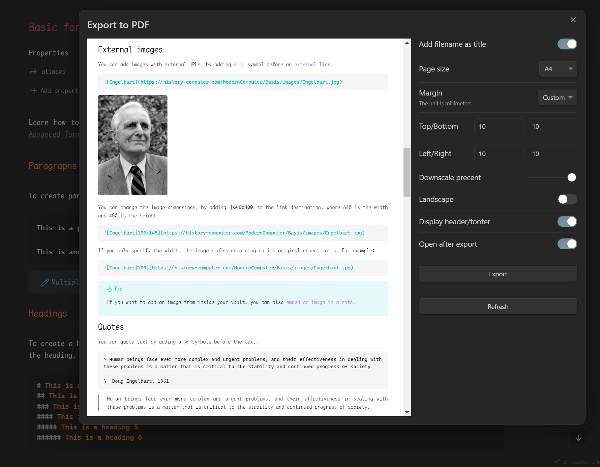
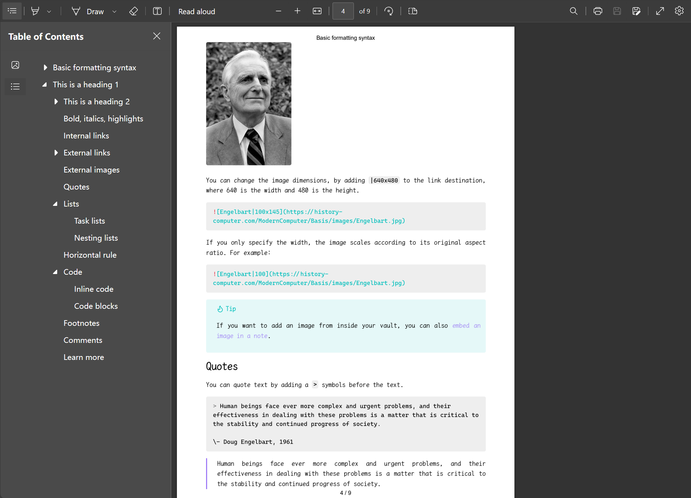

Better Export PDF adds export preview, outline bookmarks, and page numbers on top of Obsidian's PDF export.

## Features

- Export preview
- Outline bookmarks
- Custom margins
- Header and footer, including page numbers
- PDF metadata from front matter
- Internal links that still jump inside the file
- Merge a folder, or the notes you list, into one PDF
- Export each file in a folder as its own PDF
- Custom page size, including a single long page

## Installation

In Obsidian, open `Settings > Community plugins > Browse` and search for [Better Export PDF](obsidian://show-plugin?id=better-export-pdf).

### Manual installation

1. Download the zip from the [latest release](https://github.com/l1xnan/obsidian-better-export-pdf/releases).
2. Unzip it into `{VaultFolder}/.obsidian/plugins/`.
3. Reload Obsidian and enable the plugin.

Or install it with the [BRAT plugin](https://obsidian.md/plugins?id=obsidian42-brat).

## Preview

## Support

[PayPal](https://paypal.me/l1xnan). WeChat and Alipay codes are on the [中文首页](/zh/).
