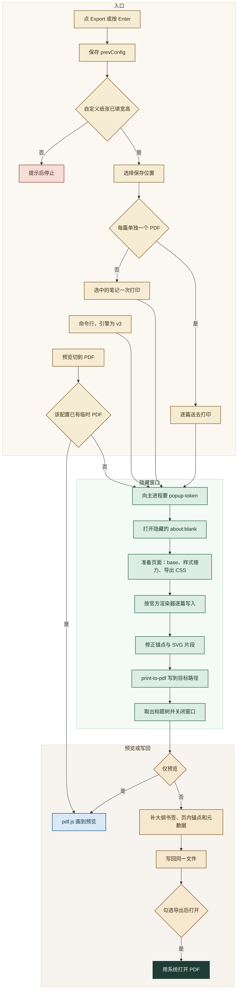

# v3 的打印流程

v3 在隐藏窗口里生成 PDF。窗口刚打开时是一张空白页。第一张图从点导出走到写出文件，第二张图展开中间的页面准备和渲染。

对话框里滚动的页面预览画在当前窗口。生成 PDF 时才打开隐藏窗口。

## 从导出到文件

沙色是进入打印的几条路，绿色是隐藏窗口里的打印，蓝色是预览，暖色是写回磁盘。深色表示文件已经交给系统打开。红色是校验没有通过、导出停住的地方。

## 从空白页到排好的页面

绿色节点在准备这张空白文档：基地址、DOM 方法、从主窗口复制来的样式，以及导出用的 CSS。蓝色节点把笔记写进去。正文先在主窗口生成，再领养到隐藏窗口，这样渲染器仍使用主窗口的样式表。暖色节点补上打印用的链接，并再等一次布局。深色表示这一页可以送去 `print-to-pdf`。导出 CSS 读失败时用红色标出，导出会继续。

两次各 200 毫秒的停顿，是留给样式和布局安定下来的时间。

```mermaid
flowchart TD
  subgraph prepare["页面准备"]
    blank["空白 about:blank"] --> comp["加载 Component"]
    comp --> base["head 插入 base，href 为主窗口地址"]
    base --> lang["复制 html 的 lang"]
    lang --> hasEnhance{"主窗口有 globalEnhance"}
    hasEnhance -->|否| ipc["等到该窗口自己的 ipcRenderer"]
    hasEnhance -->|是| enhance["用隐藏窗口的 Function 重新编译并执行"]
    enhance --> ipc
    ipc --> scan["逐个查看主窗口 head 的子节点"]
    scan --> kind{"样式节点"}
    kind -->|含编辑器标记| skipStyle["跳过编辑器样式"]
    kind -->|普通样式或样式表链接| cloneStyle["cloneNode 复制"]
    kind -->|MathJax 或空样式| serialize["把 cssRules 写成文本"]
    skipStyle ~~~ cloneStyle
    cloneStyle ~~~ serialize
    skipStyle --> ordered["base 留在最前，样式按原顺序放入"]
    cloneStyle --> ordered
    serialize --> ordered
    ordered --> bodyState["复制 body 类名，改为 theme-light"]
    bodyState --> cssVars["复制 CSS 变量，跳过缩放和键盘高度"]
    cssVars --> fontSize["把主窗口 body 字号写到 html"]
    fontSize --> watch["监听主窗口 head 与 body 的后续变化"]
    watch --> hasSnippet{"配置了导出 CSS，且不是 0"}
    hasSnippet -->|否| wait1["等待 200ms"]
    hasSnippet -->|读失败| warn["记下警告，继续导出"]
    hasSnippet -->|读到文件| snippet["把导出 CSS 放到 head 末尾"]
    warn --> wait1
    snippet --> wait1
    wait1 --> bodyAgain["再复制一次 body 类名和变量"]
    bodyAgain --> docTitle["document.title 设为第一篇文件名"]
    docTitle --> printRoot["body 中加入 div.print"]
  end

  subgraph writing["渲染写入"]
    note["取下一篇笔记"] --> view["在隐藏文档创建 markdown-preview-view"]
    view --> classes["按需加上 rtl、show-properties、cssclasses"]
    classes --> showTitle{"showTitle 不为 false"}
    showTitle -->|是| h1["插入 h1.__title__，文字为文件名"]
    showTitle -->|否| mount["空壳挂进 div.print"]
    h1 --> mount
    mount --> read["cachedRead 读取原文"]
    read --> renderMd["在主窗口生成文档片段"]
    renderMd --> capture["假元素记下子节点并抛出 exit"]
    capture --> block{"顶层节点"}
    block -->|分隔线| hrNode["直接领养进视图"]
    block -->|其他块| wrap["包一层 div 后领养进视图"]
    hrNode --> post["postProcess，并等待其中的异步任务"]
    wrap --> post
    post --> strip["去掉内部链接的 href"]
    strip --> more{"还有下一篇"}
    more -->|是| note
  end

  subgraph sealBox["补上链接并等待布局"]
    dest["每个标题追加打印锚点"] --> anchors["同页标题链接改为页内目标"]
    anchors --> svgFix["SVG 片段地址改为绝对地址"]
    svgFix --> resync["再同步样式，带上期间插入的 MathJax"]
    resync --> wait2["再等待 200ms"]
    wait2 --> ready["页面可送去 print-to-pdf"]
  end

  printRoot --> note
  more -->|否| dest

  class blank,ready ink
  class comp,base,lang,hasEnhance,enhance,ipc,scan,kind,skipStyle,cloneStyle,serialize,ordered,bodyState,cssVars,fontSize,watch,hasSnippet,snippet,wait1,bodyAgain,docTitle,printRoot prep
  class warn halt
  class note,view,classes,showTitle,h1,mount,read,renderMd,capture,block,hrNode,wrap,post,strip,more render
  class dest,anchors,svgFix,resync,wait2 seal

  classDef ink fill:#1f3d34,stroke:#163028,color:#f4f7f5,stroke-width:1.5px
  classDef prep fill:#dceee3,stroke:#2d6a4f,color:#173328,stroke-width:1.5px
  classDef render fill:#d9e8f7,stroke:#24598a,color:#16324d,stroke-width:1.5px
  classDef seal fill:#f6e7cf,stroke:#8a5a2b,color:#3d2912,stroke-width:1.5px
  classDef halt fill:#f6ddd6,stroke:#9a4638,color:#4a241c,stroke-width:1.5px

  style prepare fill:#f4faf6,stroke:#b7d4c4,color:#173328
  style writing fill:#f3f7fc,stroke:#b9cfe6,color:#16324d
  style sealBox fill:#fbf7f1,stroke:#ead7be,color:#3d2912
```

